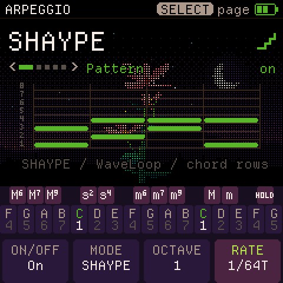
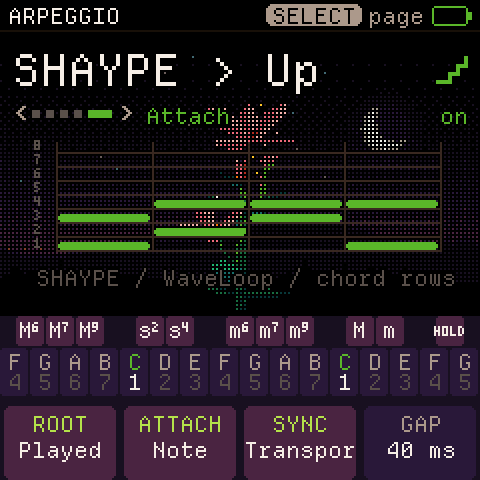

# CoralFlower + SHAYPE

WaveLoop's Shape Arp, integrated with CoralFlower's native chord player, sequencer and interface.
This is an independent opt-in fork of [FicusFicusov/CoralFlower](https://github.com/FicusFicusov/CoralFlower),
based on upstream `272cad9e85a444d879d72598807b7ca01a098d6d` (0.6.1).

## Play and edit

Press **ARP**, set **MODE** with K2 to **SHAYPE**, **SHAYPE > Up** or **SHAYPE > Down**, and turn **ON/OFF** on with K1.
Hold a chord. SELECT turns the page; keys continue to play CoralFlower's chords.
The original nine modes remain available.

| Page | K1 | K2 | K3 | K4 |
| --- | --- | --- | --- | --- |
| Pattern | On/off | Mode | Octave lift (1 = original) | Rate (straight / triplet / dotted, through 1/64) |
| Feel | Tempo | Gate | Swing | Latch |
| Shape | Starter preset | Steps (1–64) | Direction | Wrap / octave |
| Draw | Step | Chord row (1–8) | Note length (1–64 steps) | Add / remove note |
| Attach | Root floor (Played or MIDI pitch) | Now / Note / Cycle | Sync (Free / Transport) | Strum gap (5–250 ms) |

Choosing a starter replaces the drawn pattern. Changing STEPS hides notes beyond the new length;
lengthening it exposes them again. Draw the selected cell with K4; K3 stretches an existing cell's note.
A pattern holds up to 62 notes, with eight simultaneously active pitches per player. When all eight gates
are occupied, a new distinct-pitch event is skipped; an existing pitch retriggers in its own slot.
The eight rows refer to chord positions, rather than fixed pitches.

WYNDO slides the pattern group through a larger chord; SHYFT slides a chord-sized window through the pattern.
PEND travels in octaves. UP, DOWN and Random are also available. The seven starters are SHAYPE, UP 4,
UPDOWN, STABS, OCT RUN, PEDAL and DRONE. NOTE attaches a new chord at the next step; CYCLE at the next pass;
NOW retriggers the current step in Free mode; Transport waits for the next slot. On release, NOTE lets sounding gates finish; CYCLE finishes the pass and gates;
NOW stops immediately. LATCH keeps the chord after release.

SYNC = **Free** retains CoralFlower's chord-triggered behavior: rate changes join the next available grid slot
without resetting pattern position, and a stopped grid free-runs. SYNC = **Transport** joins the transport's
current step and pattern pass, including when a chord arrives late. Stop silences active and pending arp notes;
a held/latched chord resumes at the transport downbeat after restart. Changing rate joins the new division's
transport phase at its next available slot. The pattern phase does not restart with each chord.

**SHAYPE > Up / Down** strums the notes generated by each SHAYPE step, sorted low-to-high or high-to-low.
Attach-page K4 **GAP** controls spacing in milliseconds. At fast rates, spacing is shortened to keep all attacks
inside their source step. A step containing one note still sounds one note; draw multiple rows at that step
to hear a strum. Notes retain their drawn lengths from their own delayed attack.
CHORDS and LAYER sequencer tracks use separate player instances with the same shared SHAYPE pattern/settings.
Their existing ARP button assignment and live-key takeover remain available.


## Save and compatibility

The pattern and SHAYPE-specific settings autosave after 1.5 seconds without edits, once the audio is quiet.
CoralFlower's original settings record and sequencer formats are unchanged. A separate versioned WHS2 record
uses the unused CZ-store pair at **0xA0000 / 0xA1000** (CZ is disabled in CoralFlower). Writes use the native
A/B storage protocol; no flash guard is widened. Backup/restore adds **object 68**, including validation and
restore locking. Old WHS1 records migrate automatically with Sync = Free, preserving their pattern and
settings; record size grows from 140 to 144 bytes. Old CoralFlower backups without it load the default pattern. Upstream firmware will not
retain the added mode or SHAYPE object in its own backups. Keep a fork backup before downgrading.

Cross-firmware Switch Blade songs are not CoralFlower songs. Keep a complete backup before switching families.
Do not clone raw flash onto another unit.

## For CoralFlower's developer

Opt in by using this fork, or review the isolated changes against the upstream base above.
No upstream PR or developer message has been sent.

- `arp_shape.c`: unchanged pure WaveLoop core, pinned from Switch Blade `240bd0d`.
- `cf_play.c`, `cf_arp.c`, `cf_seqp.c`: adapter, bounded polyphonic gates, chord attachment and ownership.
- `cf_ui.c`, `cf_views.c`, `cf_screens.c`: native knob/page routing and themed grid.
- `cf_settings.c`, `storage.c`, `cf_backup.c`: independent pattern record and backup object.
- `tests/cf_shape_test.c`: real host player/UI/storage/protocol tests; `tests/arp_*`: donor core parity fixtures.

Build and check:

```sh
python3 tools/build.py --gen-only
sh tools/test_shape.sh
./build.sh --release 0.6.1-wlshape3
```

The native build needs Pillow/fontTools and the existing JieLi/Docker toolchain described in the root README.
The checked-in CI runs SHAYPE tests too. Screenshots are emulator renders of actual firmware, not device photos.
Host checks establish behavior and storage boundaries; physical timing and sound still need listening on hardware.

SHAYPE design and this port: **Elijah Lucian / Lucian Labs (WaveLoop)**.
CoralFlower: **FicusFicusov and contributors**; ChoralRoot: **Quixotic7 and contributors**;
Felucca: **Leo Kuroshita / Hügelton Instruments**; FM engine: **Kerem Kilic / Melodee**;
Departure Mono: **Helena Zhang**. Original source headers and GPL-3.0-only licensing are retained.
See the root README and LICENSING.md for all dependency notices.

## Hardware check — 2026-10-30

Installed on FM1-TEST as `CoralFlower 0.6.1-wlshape1` from source `5158020`.
The installer rejected a direct Switch Blade transition; official V15 was installed first,
then the fork, without a force override. The prior Switch Blade music/raw storage was backed up first.

Enabled SHAYPE through validated native settings restore (only mode, on/off and checksum changed),
restored its default pattern as object 68, and restarted. Both records read back exactly; the backup
lists 27 objects. Controlled real MIDI input produced 16 chord note-ons in eight polyphonic pairs,
then no further note-ons after release. A separate six-second play window added zero late buffers,
voice sheds or steals (CPU meter 43% during that one organ chord). Two earlier late-buffer counts
were present before that window; their cause was not isolated. This is a limited smoke check,
not a CPU stress guarantee. The agent did not physically listen to the device.

TEST is left stopped, SHAYPE selected/enabled, with no keys held. SHOW remains Switch Blade chain14;
GHOUL was untouched. Screens above are emulator renders; no hardware screenshot claim is made.

## Rate extension — wlshape2

RATE now offers **21 divisions**: each of 1/1, 1/2, 1/4, 1/8, 1/16, 1/32 and 1/64,
in straight, triplet (`T`) and dotted (`D`) forms. Dotted lasts 1.5 times the straight duration;
triplets last 2/3. The knob runs slow to fast, ending with 1/64T. Saved rate IDs 0–8 keep their
original meanings; new IDs are appended, so existing settings need no conversion. The extension
also works with the original clocked arp modes; Strum retains milliseconds.

The arp now uses a separate 96 PPQN grid. Native sequencing and MIDI clock out retain 24 PPQN.
Incoming MIDI clock anchors the fine grid every pulse; interpolation fills the interval at the
followed tempo, clamped before the next pulse. Clock fallback holds until its phase catches up.
The sample-based free-running path uses the same exact rational periods. Rate changes rejoin
the next grid slot without resetting the pattern/pass. No song or SHAYPE storage format change.

Validation: core parity, **1,854 integration/timing checks**, 134 backup checks and focused UBSan
pass. Checks cover all rate pairs with swing, labels/menu ordering, exact 64th durations,
MIDI pulse anchoring/interpolation/fallback and the unchanged native 24 PPQN grid. Target build
guards pass. These timing checks do not establish CPU headroom for every sound/pattern combination.

Installed/reboot/readback-verified on TEST as **0.6.1-wlshape2**, source `0d0d5a7`.
All 27 current song/settings objects match its fresh pre-update backup exactly; no restore was needed.
TEST is stopped. SHOW remains chain14 and GHOUL is unchanged. Physical listening of the new rates remains with the user.



## Transport and step strum — wlshape3

Optional transport-cycle lock and the two compound modes above are installed on TEST.
Validation: donor parity, 134 backup checks, 1,854 existing integration/timing checks, and **2,716 new
transport/strum/migration checks** pass. The new suite also passes focused UBSan with the existing DSP
exclusions (signed overflow, shifts, bounds/object-size and pointer overflow). It covers every rate and swing,
late chord joins/pass offsets, stop/restart/latch, ordered MIDI attacks, pending-note cancellation, GAP limits,
and checksummed WHS1 backup restore/migration. Target build guards pass; native emulator controls inspected.
Installed/reboot/readback-verified on TEST as **0.6.1-wlshape3**, source `af50798`.
A fresh 27-object backup was archived first. All 26 native song/settings objects remain byte-identical;
SHAYPE migrated to WHS2 with all 132 original data bytes preserved and Sync = Free.
Controlled target MIDI in each compound mode produced 17 chord attacks, including eight correctly
ordered strum pairs, zero attacks while stopped, and zero attacks after Stop's 40 ms grace period.
Temporary test settings/pattern were restored; all 27 current objects read back exactly. TEST is stopped,
with the user's previous settings retained. SHOW stays chain14; GHOUL is untouched. These checks establish
target MIDI behavior; physical listening and broad CPU/headroom testing remain separate.


