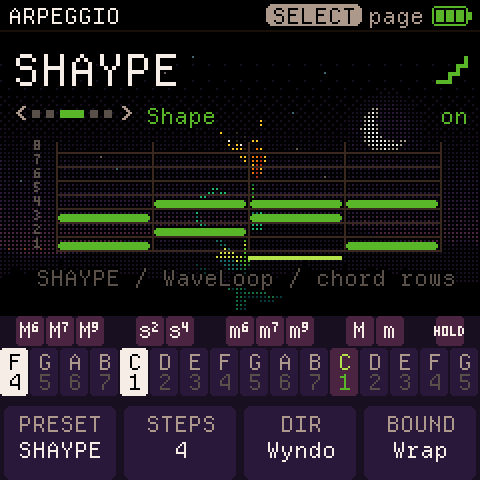
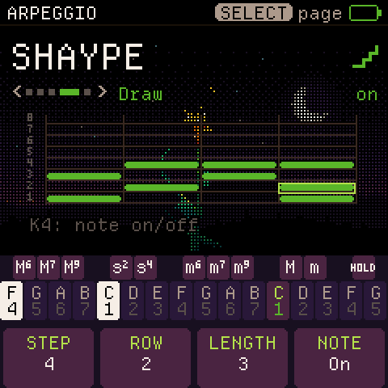

# CoralFlower + SHAYPE

WaveLoop's Shape Arp, integrated with CoralFlower's native chord player, sequencer and interface.
This is an independent opt-in fork of [FicusFicusov/CoralFlower](https://github.com/FicusFicusov/CoralFlower),
based on upstream `272cad9e85a444d879d72598807b7ca01a098d6d` (0.6.1).

## Play and edit

Press **ARP**, set **MODE** with K2 to **SHAYPE**, and turn **ON/OFF** on with K1.
Hold a chord. SELECT turns the page; keys continue to play CoralFlower's chords.
The original nine modes remain available.

| Page | K1 | K2 | K3 | K4 |
| --- | --- | --- | --- | --- |
| Pattern | On/off | Mode | Octave lift (1 = original) | Rate |
| Feel | Tempo | Gate | Swing | Latch |
| Shape | Starter preset | Steps (1–64) | Direction | Wrap / octave |
| Draw | Step | Chord row (1–8) | Note length (1–64 steps) | Add / remove note |
| Attach | Root floor (Played or MIDI pitch) | Now / Note / Cycle | Polyphony information | Save information |

Choosing a starter replaces the drawn pattern. Changing STEPS hides notes beyond the new length;
lengthening it exposes them again. Draw the selected cell with K4; K3 stretches an existing cell's note.
A pattern holds up to 62 notes, with eight simultaneously active pitches per player. When all eight gates
are occupied, a new distinct-pitch event is skipped; an existing pitch retriggers in its own slot.
The eight rows refer to chord positions, rather than fixed pitches.

WYNDO slides the pattern group through a larger chord; SHYFT slides a chord-sized window through the pattern.
PEND travels in octaves. UP, DOWN and Random are also available. The seven starters are SHAYPE, UP 4,
UPDOWN, STABS, OCT RUN, PEDAL and DRONE. NOTE attaches a new chord at the next step; CYCLE at the next pass;
NOW retriggers the current step. On release, NOTE lets sounding gates finish; CYCLE finishes the pass and gates;
NOW stops immediately. LATCH keeps the chord after release.

SHAYPE uses CoralFlower's beat grid, internal or MIDI. Rate changes join the next available grid slot without
resetting pattern position. CoralFlower's native free-running behavior remains when its beat grid is stopped.
CHORDS and LAYER sequencer tracks use separate player instances with the same shared SHAYPE pattern/settings.
Their existing ARP button assignment and live-key takeover remain available.




## Save and compatibility

The pattern and SHAYPE-specific settings autosave after 1.5 seconds without edits, once the audio is quiet.
CoralFlower's original settings record and sequencer formats are unchanged. A separate versioned WHS1 record
uses the unused CZ-store pair at **0xA0000 / 0xA1000** (CZ is disabled in CoralFlower). Writes use the native
A/B storage protocol; no flash guard is widened. Backup/restore adds **object 68**, including validation and
restore locking; old CoralFlower backups without it load the default pattern. Upstream firmware will not
retain the added mode or SHAYPE object in its own backups. Keep a fork backup before downgrading.

Cross-firmware Switch Blade songs are not CoralFlower songs. Keep a complete backup before switching families.
Do not clone raw flash onto another unit.

## For CoralFlower's developer

Opt in by using this fork, or review the isolated changes against the upstream base above.
No upstream PR or developer message has been sent.

- `arp_shape.c`: unchanged pure WaveLoop core, pinned from Switch Blade `240bd0d`.
- `cf_play.c`, `cf_arp.c`, `cf_seqp.c`: adapter, bounded polyphonic gates, chord attachment and ownership.
- `cf_ui.c`, `cf_views.c`, `cf_screens.c`: native knob/page routing and themed grid.
- `cf_settings.c`, `storage.c`, `cf_backup.c`: independent pattern record and backup object.
- `tests/cf_shape_test.c`: real host player/UI/storage/protocol tests; `tests/arp_*`: donor core parity fixtures.

Build and check:

```sh
python3 tools/build.py --gen-only
sh tools/test_shape.sh
./build.sh --release 0.6.1-wlshape1
```

The native build needs Pillow/fontTools and the existing JieLi/Docker toolchain described in the root README.
The checked-in CI runs SHAYPE tests too. Screenshots are emulator renders of actual firmware, not device photos.
Host checks establish behavior and storage boundaries; physical timing and sound still need listening on hardware.

SHAYPE design and this port: **Elijah Lucian / Lucian Labs (WaveLoop)**.
CoralFlower: **FicusFicusov and contributors**; ChoralRoot: **Quixotic7 and contributors**;
Felucca: **Leo Kuroshita / Hügelton Instruments**; FM engine: **Kerem Kilic / Melodee**;
Departure Mono: **Helena Zhang**. Original source headers and GPL-3.0-only licensing are retained.
See the root README and LICENSING.md for all dependency notices.
